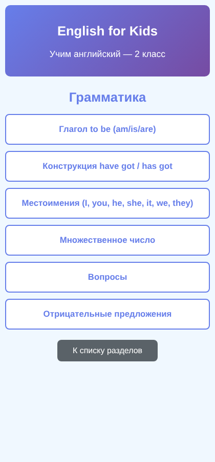
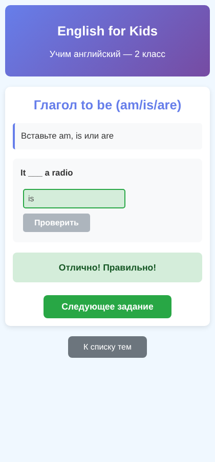
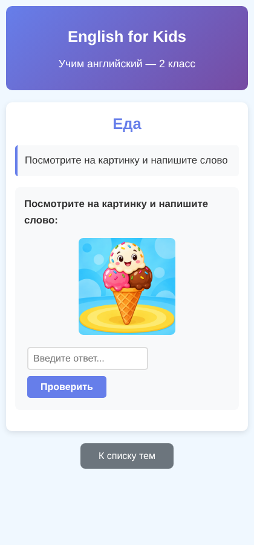

# English for Kids

Тренажёр английского языка для учеников второго класса. Здесь можно заниматься грамматикой, чтением и новыми словами, слушать произношение и следить за своими успехами. Во время занятий помогает Тоби.

## Что можно делать

- Выполнять задания с выбором ответа, вводом слов, картинками и сопоставлением.
- Слушать английские слова и выбирать услышанный вариант.
- Возвращаться к разным темам и постепенно проходить новые задания.
- Смотреть результаты занятий в разделе «Мой прогресс».

## Скриншоты

**Главная страница**

**Выбор раздела и темы**

**Пример упражнения**

**Задание с картинкой**

## Сохранение результатов

Имя ученика и результаты сохраняются в браузере на том устройстве, где проходят занятия. На другом устройстве эти данные не появятся. При очистке данных браузера сохранённые результаты могут удалиться.

Звуки нажатий и ответов короткие и ненавязчивые. Их громкость можно дополнительно изменить на самом устройстве.
