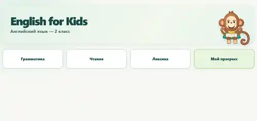
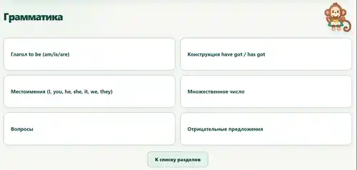
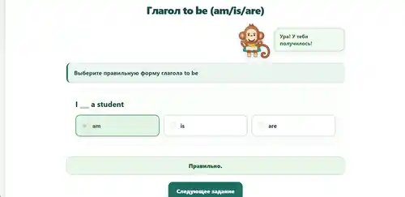
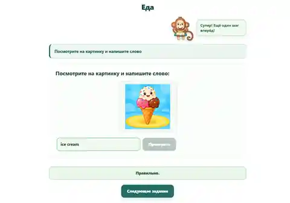
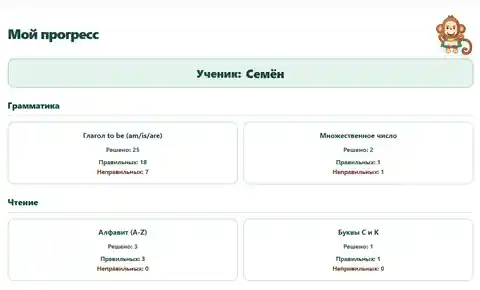

# English for Kids

Интерактивный тренажёр английского языка для учеников второго класса. Здесь можно заниматься грамматикой, чтением и лексикой, слушать произношение и следить за своими успехами. Во время занятий помогает Тоби.

## Главная страница

На главной странице можно выбрать один из трёх учебных разделов или открыть свои результаты.

## Выбор темы

В каждом разделе собраны темы с отдельными упражнениями.

## Упражнение

Задания помогают закрепить правила и новые слова. Нужно выбрать правильный ответ или вписать слово.

## Упражнение с картинкой

Некоторые задания используют изображения, чтобы учиться было интереснее.

## Мой прогресс

В этом разделе ученик может посмотреть, сколько заданий выполнено и сколько ответов было правильными.

## Сохранение результатов

Имя ученика и результаты занятий сохраняются в браузере на том устройстве, где проходят занятия. На другом устройстве эти данные не появятся. При очистке данных браузера сохранённые результаты могут удалиться.
