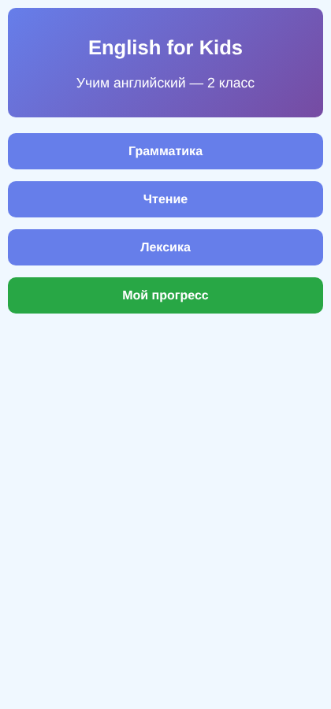

# English for Kids


Интерактивный тренажёр по английскому языку для учеников 2 класса. Грамматика, чтение и лексика собраны в короткие задания с картинками, озвучкой и мгновенной проверкой ответов. Сайт работает прямо в браузере: без сервера, без регистрации и без установки.

<table>
  <tr>
    <td></td>
    <td></td>
    <td></td>
    <td></td>
  </tr>
  <tr>
    <td align="center">Главный экран</td>
    <td align="center">Темы раздела</td>
    <td align="center">Вписать слово</td>
    <td align="center">Угадать по картинке</td>
  </tr>
</table>

## Содержание

- [Возможности](#возможности)
- [Темы](#темы)
- [Типы заданий](#типы-заданий)
- [Быстрый старт](#быстрый-старт)
- [Публикация на GitHub Pages](#публикация-на-github-pages)
- [Структура проекта](#структура-проекта)
- [Как работает прогресс](#как-работает-прогресс)
- [Как добавить новое задание](#как-добавить-новое-задание)
- [Ограничения и планы](#ограничения-и-планы)
- [Участие в проекте](#участие-в-проекте)
- [Автор](#автор)

## Возможности

- **17 тем** в трёх разделах: грамматика, чтение, лексика.
- **Семь типов заданий**: выбор ответа, вписывание слова, сопоставление пар, задания по картинкам и эмодзи, аудирование.
- **Озвучка** английских слов, букв и чисел средствами браузера (Web Speech API).
- **Мгновенная обратная связь**: правильный ответ подсвечивается, после ошибки показывается верный вариант.
- **Случайный порядок** вопросов: в рамках темы вопросы не повторяются, пока не показаны все.
- **Личный прогресс**: ученик вводит имя, а результаты по каждой теме сохраняются и показываются на странице «Мой прогресс».
- **Адаптивная вёрстка**: одинаково удобно на телефоне, планшете и компьютере.
- **Нет зависимостей**: только HTML, CSS и JavaScript, сборка не нужна.

## Темы

| Раздел | Темы |
| --- | --- |
| Грамматика | глагол *to be*, *have got / has got*, местоимения, множественное число, вопросы, отрицательные предложения |
| Чтение | алфавит (A–Z), буквосочетания (*sh, ch, th, ph, ck*), долгие и краткие гласные, буквы C и K |
| Лексика | семья, цвета, числа 1–12, дом, еда, животные, эмоции |

## Типы заданий

| Тип | Что нужно сделать ученику |
| --- | --- |
| Выбор ответа | выбрать правильный вариант из нескольких |
| Вписать слово | ввести ответ и нажать «Проверить» или Enter |
| Сопоставление | соединить пары (слово и перевод, заглавная и строчная буква) |
| Слово по картинке | посмотреть на картинку и написать слово |
| Выбор по картинке | выбрать цвет предмета на картинке |
| Эмоции | угадать эмоцию по эмодзи |
| Аудирование | послушать слово, букву или число и выбрать ответ |

## Быстрый старт

Нужен только современный браузер: Chrome, Edge, Firefox или Safari.

**Вариант 1. Открыть файл.** Скачайте репозиторий и откройте `index.html` двойным щелчком.

```bash
git clone https://github.com/semyon-11/english-site.git
cd english-site
```

**Вариант 2. Запустить локальный сервер.** Так сайт ведёт себя так же, как в интернете.

```bash
# Python 3
python -m http.server 8000

# или Node.js
npx serve .
```

После этого откройте <http://localhost:8000>.

> Озвучка использует голоса вашей операционной системы. Если звука нет, проверьте, что в системе установлен английский голос (en-US) и звук включён.

## Публикация на GitHub Pages

1. Откройте репозиторий на GitHub и перейдите в **Settings → Pages**.
2. В разделе **Build and deployment** выберите **Deploy from a branch**.
3. Укажите ветку `main` и папку `/ (root)`, затем нажмите **Save**.
4. Через минуту-две сайт станет доступен по адресу вида `https://<имя-пользователя>.github.io/english-site/`.

## Структура проекта

```text
english-site/
├── docs/
│   └── screenshots/   # скриншоты для README
├── css/
│   └── style.css      # Оформление и адаптивная вёрстка
├── images/            # Иллюстрации для заданий
├── js/
│   ├── content.js     # Учебные данные и названия разделов
│   ├── state.js       # Состояние приложения
│   ├── utils.js       # Общие вспомогательные функции
│   ├── speech.js      # Озвучивание
│   ├── progress.js    # Хранение и отображение прогресса
│   ├── exercise-generators.js # Генерация динамических заданий
│   ├── exercises.js   # Отображение и проверка заданий
│   └── app.js         # Навигация и запуск приложения
├── index.html
└── README.md
```

Все учебные задания и варианты ответов находятся в объекте `content` в `js/content.js`. Логика приложения разделена по назначению на отдельные файлы в `js/`. Новая тема автоматически появляется в разделе прогресса после добавления в `content` — поддерживать отдельный список тем больше не нужно.

Сайт по-прежнему работает без сборки и сторонних зависимостей: файлы JavaScript подключаются обычными тегами `script` в `index.html`. Открытие `index.html` напрямую и публикация на GitHub Pages остаются поддерживаемыми способами запуска.

## Как работает прогресс

Результаты хранятся в `localStorage` браузера, на сервер ничего не отправляется.

| Ключ | Содержимое |
| --- | --- |
| `studentName` | имя ученика, введённое при первом запуске |
| `progress` | массив записей по каждому выполненному заданию |

Одна запись выглядит так:

```json
{
  "name": "Анна",
  "topic": "toBe",
  "exerciseType": "multipleChoice",
  "isCorrect": true,
  "date": "25.10.2026",
  "time": "13:05:42",
  "timeTaken": 7
}
```

`timeTaken` — время ответа в секундах. Чтобы начать заново, очистите данные сайта в настройках браузера или выполните в консоли `localStorage.clear()`.

> Прогресс привязан к браузеру и устройству. На другом устройстве или в режиме инкогнито он будет пустым.

## Как добавить новое задание

Добавьте тему в объект `content` в `js/content.js`:

```js
const content = {
    vocabulary: {
        weather: {
            title: 'Погода',
            exercises: [
                {
                    type: 'fillBlank',
                    instruction: 'Напишите слово на английском',
                    questions: [
                        { q: 'солнечно - ___', a: ['sunny'] },
                        { q: 'дождливо - ___', a: ['rainy'] }
                    ]
                }
            ]
        }
    }
};
```

Отдельно регистрировать тему для страницы прогресса не нужно: список тем берётся непосредственно из объекта `content`.

Поля вопросов для каждого типа:

| `type` | Поля вопроса |
| --- | --- |
| `multipleChoice` | `q`, `options` (массив), `a` (индекс верного варианта), необязательно `image` |
| `fillBlank` | `q` (пропуск обозначается `___`), `a` (массив допустимых ответов) |
| `imageWord` | `q`, `image`, `a` (массив допустимых ответов) |
| `imageChoice` | `q`, `image`, `options`, `a` (индекс) |
| `emojiChoice` | `emoji`, `options`, `a` (индекс) |
| `audio` | `audio` (текст для озвучки), `options`, `a` (индекс) |
| `matching` | вместо `questions` массив `pairs`: `{ left, right }` |

Полезно знать:

- Картинки лежат в `images/`, в поле `image` пишется имя файла без расширения: для `images/cat.png` это `'cat'`.
- Ответы в `fillBlank` и `imageWord` не зависят от регистра и лишних пробелов. Для вариантов написания перечисляйте их в массиве: `['ice cream', 'ice-cream']`.
- Задания по алфавиту, буквосочетаниям и звукам (`caseMatching`, `audioAlphabet`, `audioBlends`, `audioSounds`) создаются функциями `generate…Exercise`. Их данные лежат в `allLetters`, `blendWords` и `soundWords`.

## Ограничения и планы

Сейчас проект устроен просто, и у этого есть цена:

- прогресс хранится только в браузере и не переносится между устройствами;
- нет автоматических тестов.

Идеи для развития:

- [ ] экспорт прогресса в файл для учителя или родителей;
- [ ] сжатие тяжёлых картинок, чтобы страницы грузились быстрее на мобильном интернете;
- [ ] новые темы: погода, одежда, части тела, дни недели;
- [ ] режим «повторить ошибки»;
- [ ] вынести данные заданий в отдельный файл `content.js`.

## Участие в проекте

Предложения и исправления приветствуются.

1. Создайте issue с описанием ошибки или идеи.
2. Для правок сделайте форк, создайте ветку, внесите изменения и откройте pull request.
3. Перед отправкой пройдите свою тему в браузере целиком: убедитесь, что картинки загружаются, а правильные ответы принимаются.

## Автор

Семён, [@semyon-11](https://github.com/semyon-11).
